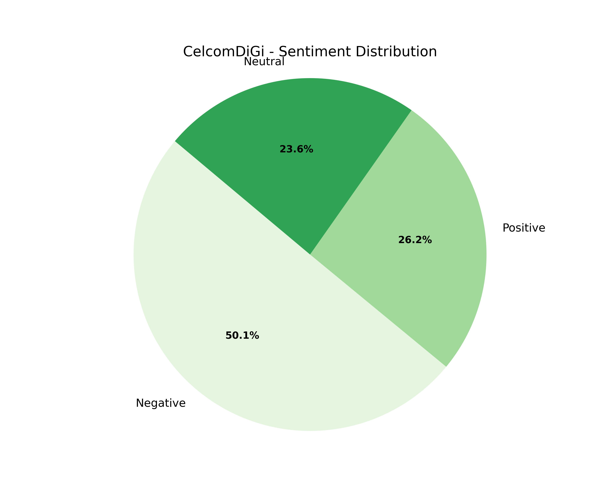
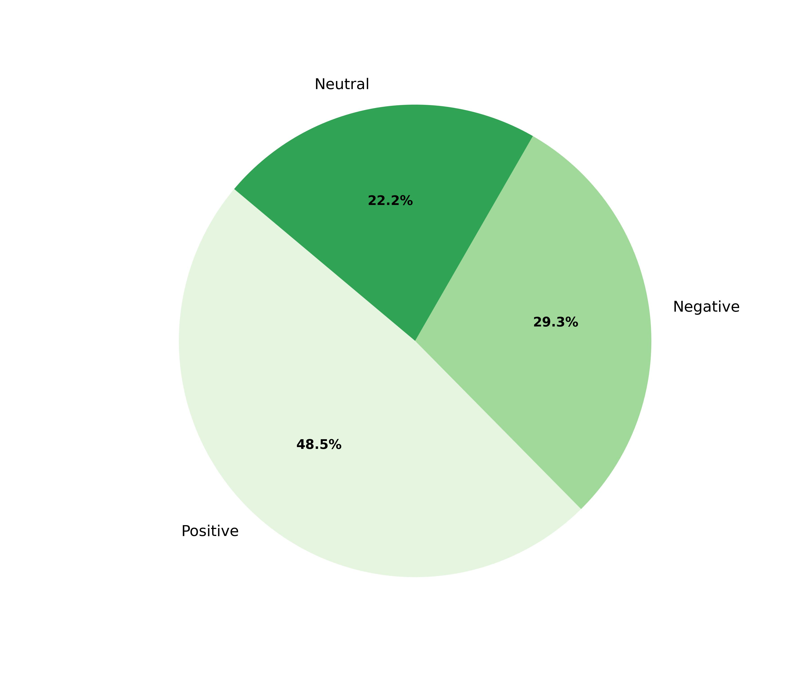
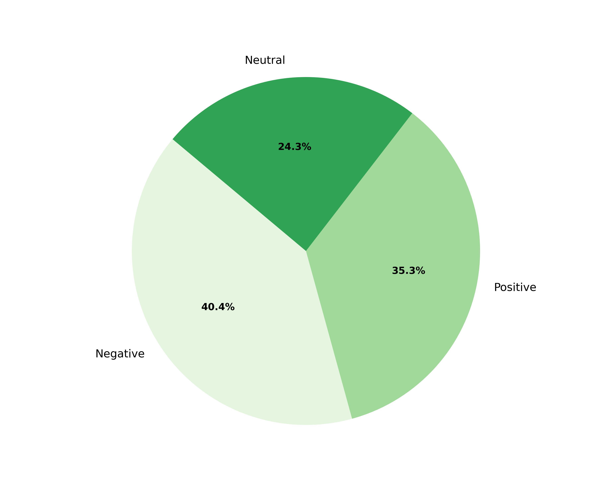
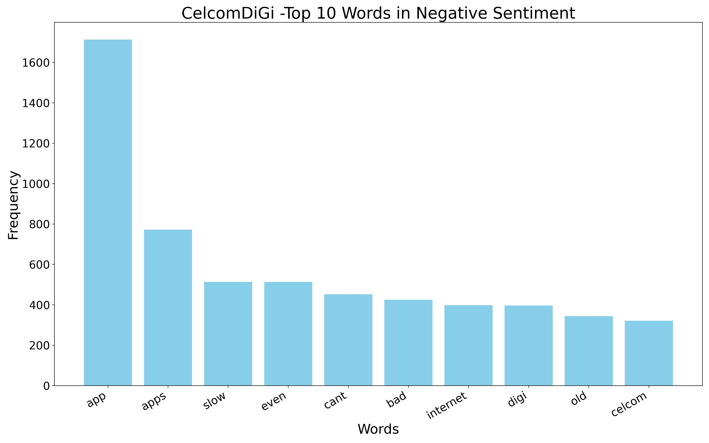
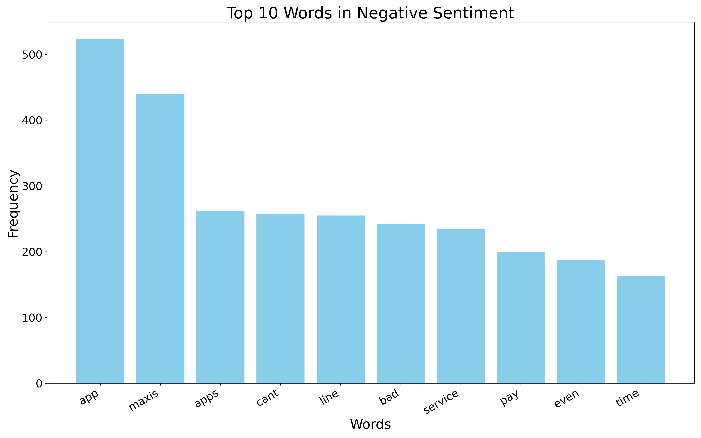
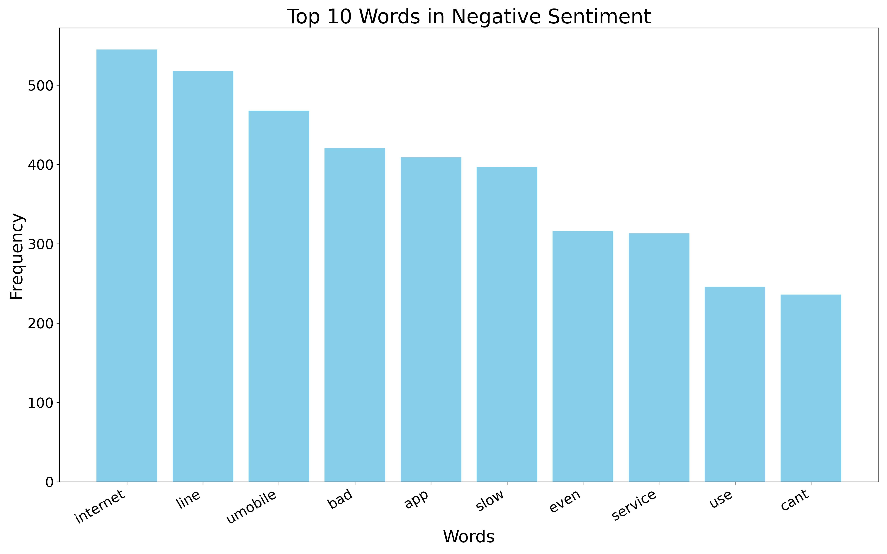

# Customer Sentiment Toward Malaysian Telecom Apps (VADER)

Python pipeline that collects Google Play reviews for the three largest Malaysian mobile operators' self-care apps, translates non-English reviews, cleans the text, scores sentiment with NLTK VADER, and visualizes sentiment distribution, trends over time, and the most frequent complaint terms.

Built for my Master of Business Analytics capstone at Universiti Sains Malaysia (2026): *Exploring Customer Sentiments Toward Service Quality Issues in Malaysia's Mobile Telecommunications Industry Using VADER Sentiment Analysis.*

## Results

About 15,500 reviews collected (5,174 per app); 15,252 scored after cleaning.

| Provider | Reviews scored | Positive | Neutral | Negative | Mean VADER compound | Mean star rating |
|---|---|---|---|---|---|---|
| CelcomDigi | 5,156 | 26.2% | 23.6% | 50.1% | -0.145 | 1.33 |
| Maxis | 5,051 | 48.5% | 22.2% | 29.3% | 0.084 | 2.85 |
| U Mobile | 5,045 | 35.3% | 24.3% | 40.4% | -0.050 | 2.20 |

Full table: [`results/summary_by_provider.csv`](results/summary_by_provider.csv)

Key findings:
- CelcomDigi had the most negative sentiment; "slow", "cant", "old", and "open" dominate its reviews, pointing to app performance and access problems.
- Maxis had the most positive sentiment, with "good" and "easy" leading positive reviews; negatives centre on "line", "pay", and "service".
- U Mobile complaints focus on network quality: "internet", "line", and "slow" are the top negative terms.

| CelcomDigi | Maxis | U Mobile |
|---|---|---|
|  |  |  |
|  |  |  |

## Pipeline

1. **Collect** (`notebooks/01_collect/`): `google-play-scraper` pulls the newest reviews (country `my`) with continuation-token paging and de-duplication by `reviewId`, then saves them to CSV.
2. **Translate**: `langdetect` identifies non-English reviews (mostly Malay) and `deep-translator` converts them to English.
3. **Clean**: lowercase; remove URLs, emojis, mentions, and punctuation; tokenize; remove stop words while keeping negations (`not`, `no`, `nor`); stem and lemmatize.
4. **Score** (`notebooks/02_analyze/`): NLTK VADER compound score, labeled Positive (> 0.05), Negative (< -0.05), or Neutral.
5. **Visualize**: sentiment share, smoothed daily/monthly/yearly trends, top-10 words per sentiment, and word clouds.

## Run it

```bash
pip install -r requirements.txt
python -m nltk.downloader stopwords punkt wordnet vader_lexicon
jupyter lab
```

Run a collection notebook, then the matching analysis notebook.

## Limitations

- Review windows differ by app because each pull took the newest 5,174 reviews: CelcomDigi covers Jan–Apr 2026, U Mobile Jun 2023–Apr 2026, Maxis Mar 2021–Apr 2026. Cross-provider comparisons should be read with that in mind.
- VADER is a lexicon model tuned for English social media text; machine translation of Malay and Manglish reviews can lose nuance.
- The cleaning step removes the substring `rt` (a Twitter retweet rule), which also clips words such as "start" and "support". A word-boundary pattern (`\brt\b`) would fix this.

## Data and privacy

Raw review files are excluded because they contain reviewer names and profile images. See [`data/README.md`](data/README.md).
